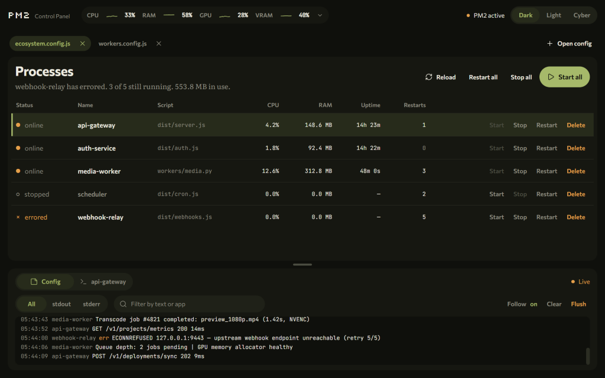
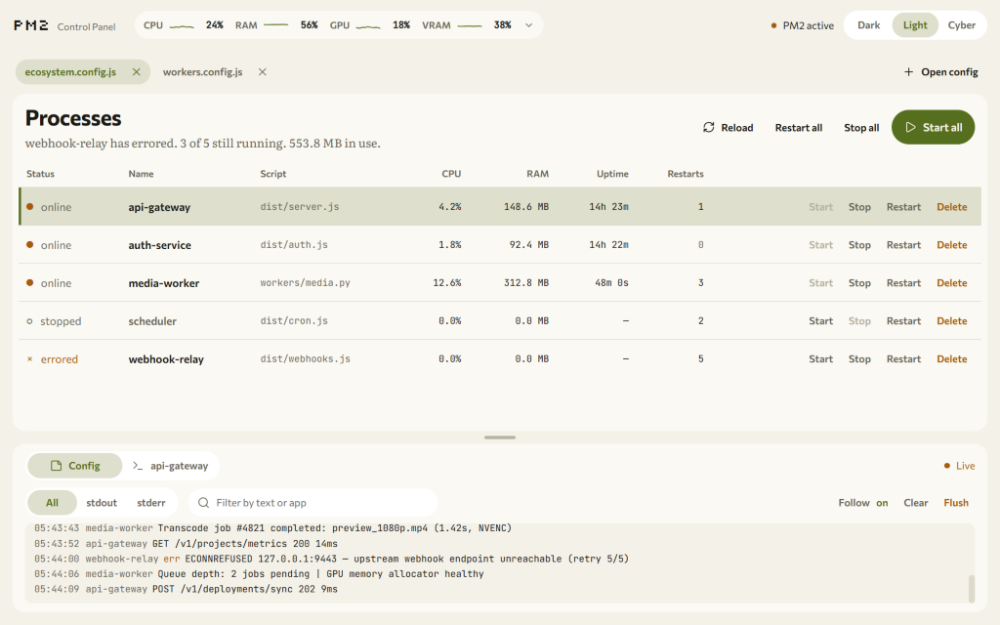
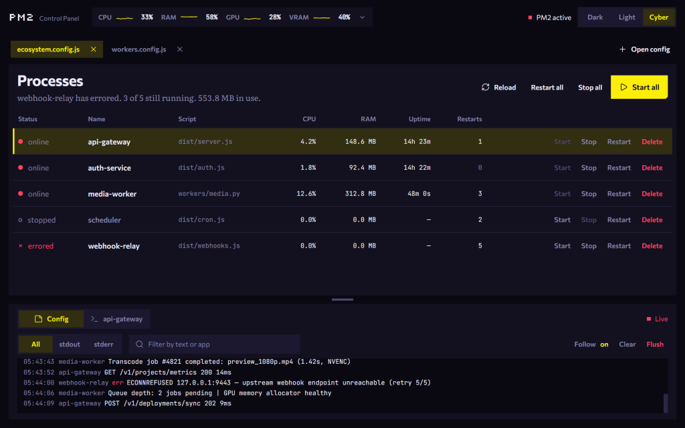

<div align="center">

# PM2 Control Panel

Windows desktop app for managing PM2 processes, ecosystem configs, real-time logs, and host metrics.


</div>



<details>
<summary>More themes — Light &amp; Cyber</summary>

| Light | Cyber |
| :---: | :---: |
|  |  |

</details>

## Features

- **Multi-tab ecosystem configs** — Open multiple `ecosystem.config.js` / `.cjs` / `.mjs` files via file dialog or drag-and-drop, watch files for changes, and restore open tabs on restart.
- **Process lifecycle control** — Start, stop, restart, and delete individual apps or entire configs with live status, CPU, memory, uptime, and restart metrics.
- **Real-time log viewer** — Resizable panel with config-wide and per-process tabs, `stdout` / `stderr` streaming, search, autoscroll, and log flushing.
- **Host system monitors** — Header sparklines for CPU, RAM, GPU, and VRAM with expandable 60-second charts (`nvidia-smi` with Windows performance counter fallback).
- **Hidden Windows consoles** — Suppresses console popup windows for Node.js and Python child processes spawned by PM2.
- **Environment setup** — Detects Node.js, npm, and PM2 versions and can install missing tools via WinGet and `npm i -g pm2`.
- **Theme switching** — Built-in `dark`, `light`, and `cyber` themes persisted across sessions.
- **Windows installer** — Step-by-step NSIS wizard with custom install path, product subfolder, and Desktop / Start Menu shortcuts.

## Tech Stack

| Layer | Technology |
| :--- | :--- |
| Desktop Runtime | Electron 33, electron-vite, electron-builder (NSIS) |
| Frontend | React 18, TypeScript, Tailwind CSS |
| IPC & Persistence | Strict `contextBridge` (`window.api`), `electron-store` |

Security defaults: `nodeIntegration: false`, `contextIsolation: true`.

## Getting Started

### Prerequisites

- Windows 10/11 (x64)
- [Node.js](https://nodejs.org/) & npm
- [PM2](https://pm2.keymetrics.io/) (can also be installed from inside the app via WinGet / npm)

### Installation

```bash
git clone https://github.com/Oatis123/PM2-Control-Panel.git
cd PM2-Control-Panel
npm install
```

### Development

```bash
npm run dev
```

### Available Scripts

| Command | Description |
| :--- | :--- |
| `npm run dev` | Start Vite dev server and Electron app |
| `npm run build` | Build main, preload, and renderer bundles |
| `npm run preview` | Preview the production build |
| `npm run typecheck` | Run TypeScript checks for Node and web targets |
| `npm run dist` | Build the NSIS Windows installer into `release/` |
| `npm run dist:dir` | Build an unpacked Windows directory for smoke testing |

## Usage

Open any PM2 ecosystem file via **Open Config** (`+`) or drag and drop it onto the window. A sample config is included at `examples/ecosystem.config.js`.

To package the Windows installer:

```bash
npm run dist
```

This outputs `release/PM2 Control Panel-Setup-<version>.exe` using the NSIS wizard configured in `electron-builder.yml`.

## Project Structure

```text
.
├── electron/       # Main process, preload bridge, IPC handlers, and services
├── src/            # React renderer UI, hooks, themes, and components
├── shared/         # Shared TypeScript types and IPC channel definitions
├── resources/      # App icons, NSIS include script, and Windows console-hiding helpers
├── examples/       # Sample PM2 ecosystem config and echo server
└── scripts/        # Local environment and PM2 detection test scripts
```

## License

MIT

---

<p align="center">made with 💚</p>
